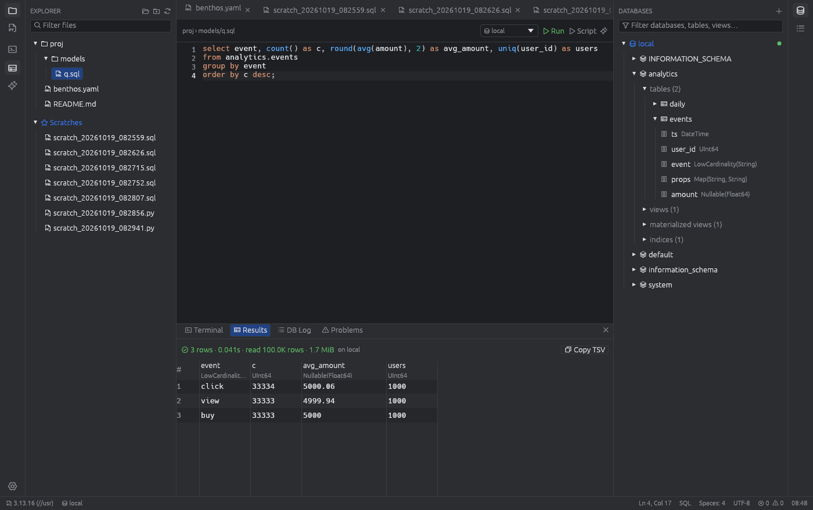

# Ludo

A small, fast, native IDE for data engineering, written in Rust ([egui](https://github.com/emilk/egui)).
It's built for ClickHouse work, benthos/dbt YAML, SQL scratches and the odd Airflow/FastAPI Python project.



## Features

**Databases (right panel)**
- ClickHouse over HTTP(S). Add several connections; a URL + user pair can only exist once.
- **Deactivate** (right-click the active connection, or the editor's connection picker) disconnects at once: a running
  query is killed on the server, the tree is closed, and nothing runs until you pick another connection.
- Passwords are stored in the **macOS Keychain** (service "Ludo database connection"), never in `settings.json`.
  Passwords from older settings files move there automatically on first launch.
- Browse databases → tables / views / materialized views / dictionaries / skip indices → columns.
  Row counts and sizes show on hover.
- **Choose which databases are shown** per connection (right-click the connection → *Edit…* → *Only selected*,
  with a searchable checklist), or right-click a database → *Hide from tree*.
- **Search** box:
  - `ad|timofeev` (or `ad timofeev`) shows databases containing either word.
  - A word that matches no database searches table/view names instead (`events`).
  - `ad.events` finds tables containing "events" in databases containing "ad"; `.events` finds tables only.
  - Hidden databases are searched too and appear dimmed. Table search indexes all objects with one query.
- **Quick inspect**: double-click a table (or use the context menu) to run `SELECT * … LIMIT 500`.
- **Show CREATE statement** for an object, or the **whole database DDL** (all `CREATE` statements).
- Run SQL from any `.sql` file: `⌘↵` runs the statement at the cursor (or the selection),
  `⌘⇧↵` runs the whole script statement by statement. Cancel sends `KILL QUERY`.
- Results grid (hover a column name for its type) with NULLs and rows/bytes read. Copy a cell or row, or the
  whole result as **TSV, CSV, plain text, SQL INSERTs, JSON or Markdown**. Set the default format in Settings → Coding.
- **DB Log**: every request with timestamp, endpoint, query id, server summary header, HTTP status and timing.
- SQL linting with the active connection's dialect (sqlparser). It's advisory: the parser doesn't know every
  ClickHouse extension. dbt Jinja (`{{ }}`, ``, `{# #}`) is ignored by the linter and highlighted.

**dbt**
- In a dbt project (a `dbt_project.yml` above the file), SQL models get a **Compile** button. It asks once for each
  `env_var()`/`var()` value (and remembers your answers), then:
  - turns `source('a', 'b')` into `a.b`
  - turns `ref('m')` into `<project>_marts.m` (the schema can be edited and is remembered per project)
  - drops `config()` and `` blocks
  - writes the result to `Scratches/compiled/<project>/<model>_cmp_<timestamp>.sql` and opens it, ready to run.
- Macros and loops it can't resolve are left as-is, and Ludo lists them.
- `⌘`-click a `ref('model')` to open that model's file (searched across the project, preferring `models/`).

**Editor**
- Up to 10 tabs (when you open an 11th, the least recently used *saved* tab closes). Tabs and folders are restored on the next launch.
- Syntax highlighting for SQL, Python, YAML, Shell, Markdown, JSON, TOML and diffs.
- Selection + `(` `[` `{` `<` `"` `'` `` ` `` wraps the selection.
- `⌥⇧↑` / `⌥⇧↓` move the current line(s), `⌘]` / `⌘[` (or `Tab` / `⇧Tab`) indent/outdent the line(s), keeping the cursor in place,
  `⌘/` toggles comments (`--` for SQL, `#` for Python/Shell/YAML). Enter keeps indentation and adds a level after `:` `(` `[` `{`.
- `⌘R` find / replace in the current file.
- YAML lint: syntax errors, duplicate keys (reported on the duplicate line), tab indentation, odd indentation, trailing whitespace.
- Markdown: edit, split view or preview (toolbar toggles).

**Workspace**
- One or several folders per workspace (Explorer → *Add folder*), with new/rename/delete/reveal in the context menu.
- **Open in Claude** in the folder context menu starts Claude Code in that project's root (or in Scratches).
- **Collapse all** button in the Explorer header.
- **Filter** (same rules as the Databases search, × clears it): `.sql|.yml` shows only matching files, and folders
  without matches are hidden. A word that matches a folder name shows that whole folder. `models/orders` finds files
  with "orders" inside folders with "models"; `models/` matches folders only, `/orders` files only.
- **Copy path ▸** offers the absolute path, the path from the project (`attribution/models/x.sql`), the path relative to
  the project (`models/x.sql`), the file name and the name without extension.
- **Find in project** (`⌘F`, magnifier in the left bar): searches file names and contents in every workspace folder
  and Scratches as you type. *Aa* matches case; *Files to include* takes the Explorer filter syntax (`.sql`, `models/`).
  Click a result to jump to the match. `node_modules`, `target`, `dbt_packages`, virtualenvs and binary files are skipped.
- **Scratches** (`~/LudoScratches`, configurable) are always listed, whatever project is open. You can make subfolders and
  SQL/Python/shell/Markdown scratches; `⌘N` creates a new SQL scratch. SQL scratches run on the active connection,
  Python scratches on the selected interpreter.

**Git** (branch icon in the left bar, `⌘⇧G`, or click the branch in the status bar)
- Uses your `git`, so credentials and hooks work as in the terminal (it never waits on a password prompt; it reports the error instead).
- Changes and staged changes, with stage (+), unstage (−), discard (↺, asks first; untracked files are deleted) and open file.
  Click a file for its diff. Right-click a section header to stage, unstage or discard everything.
- Commit message + **Commit** (`⌘↵` in the message box). With nothing staged it commits everything, like VS Code.
  The ▾ menu has *Commit & push* and *Amend last commit*.
- **Pull** / **Push** show how many commits you're behind/ahead. The first push of a new branch sets its upstream.
  ☁ fetches all remotes.
- The branch menu switches branches (local, or remote ones as a tracking branch) and creates a new branch from the current one.
- With several repositories in the workspace, pick one at the top (it follows the file you're editing).

**Terminals and Python**
- Several terminal sessions (a real PTY with 256 colors and truecolor). Double-click a tab to rename it. Each one starts as a login shell in the project root.
- Select text in the terminal with the mouse (double-click selects a word) and copy it with `⌘C` or the right-click menu.
- Python: pick an interpreter executable (or *Detect* Homebrew/pyenv/`.venv`s), create a venv, and run the current file with `⌘↵`.
  It runs in a terminal tab through your login shell, so `PATH` matches your normal terminal.
- **Claude Code**: the ✨ button opens `claude` in a terminal in the current project. The editor toolbar's ✨ starts it with the current file as context.

**Settings** (`⌘,`) are split into *General* (theme, interface/editor font from system fonts, font size, scale in 10% steps, indentation 2/4/6),
*Coding* (interpreters, connections, linting, limits), *Terminal* (shell, font size, scrollback, env vars), *Others*
(scratches folder, session restore, autosave, Claude command) and *Shortcuts* (a read-only list of every shortcut). They're stored in `~/Library/Application Support/ludo/settings.json`.

## Shortcuts

The full list is in Settings → *Shortcuts*. The main ones:

| Action | Keys |
|---|---|
| Run statement / selection · run script | `⌘↵` · `⌘⇧↵` |
| Find in project · find / replace in file | `⌘F` (or `⌘⇧F`) · `⌘R` |
| Indent · outdent · comment | `⌘]` · `⌘[` · `⌘/` |
| Open a dbt `ref('model')` | `⌘`-click |
| Next / previous tab | `⌃Tab` / `⌃⇧Tab` (also `⌘⇧]` / `⌘⇧[`), `⌘1…9` |
| Save · close tab · new SQL scratch | `⌘S` · `⌘W` · `⌘N` |
| Toggle explorer · bottom panel · databases · Git | `⌘B` · `⌘J` · `⌘⇧D` · `⌘⇧G` |
| New terminal | `⌘⇧`` ` |
| Zoom interface | `⌘+` / `⌘-` |
| Settings | `⌘,` |

## Build

```sh
cargo run --release -- ~/path/to/project      # run from source
scripts/bundle_macos.sh                        # dist/Ludo.app (universal) + zip
scripts/bundle_macos.sh --native               # host architecture only (faster)
```

Every push builds a universal `Ludo.app` on GitHub Actions (artifact **Ludo-macos**). Publishing a GitHub release
attaches `Ludo-<version>-macos.zip` to it automatically. For an existing release, run the **build** workflow manually
(Actions → build → Run workflow) and enter the tag.

The app is ad-hoc signed, not notarized, so macOS blocks it the first time. After unzipping, either run
`xattr -dr com.apple.quarantine Ludo.app` or open it once and allow it in System Settings → Privacy & Security → *Open Anyway*.

## Architecture

```
src/
  app.rs            state, per-frame logic, global shortcuts, run actions
  settings.rs       settings + session persistence (JSON)
  theme.rs          palettes → egui visuals          (add a theme: one entry in THEMES)
  languages.rs      language registry                (add a language: one entry in LANGUAGES)
  editor/           document model, text ops (unit-tested), highlighter, editor widget
  lint/             sql.rs, yaml.rs                  (add a linter: a module + a match arm)
  db/               Driver trait, ClickHouse driver, background worker
  terminal.rs       PTY + vt100 terminal widget
  git.rs            branch for the status bar + git CLI operations
  dbt.rs            dbt project detection, Jinja-aware lint, compile, ref() lookup
  file_filter.rs    Explorer filter syntax
  project_search.rs Find in project (background search)
  shortcuts.rs      the shortcut list shown in Settings
  ui/               panels: explorer, find, git, databases, bottom panel, settings, find bar, chrome
```

### Adding a database engine

1. Add a variant to `db::DriverKind`, and fill in its `name`, `default_url`, `sql_dialect` and `connect`.
2. Implement `db::Driver` (`databases`, `objects`, `columns`, `object_ddl`, `database_ddl`, `query`, `cancel`, `inspect_sql`) in a new module.

The panel, results grid, log, linting and connection editor work unchanged, because they only talk to the trait.

## Development

```sh
cargo test                                               # unit tests (on Linux: `keyctl session - cargo test`
                                                         # to exercise the kernel keyring instead of skipping)
LUDO_CH_URL=http://localhost:8123 cargo test -- --ignored # live ClickHouse test
```

The live test expects an `analytics` database:

```sql
CREATE DATABASE analytics;
CREATE TABLE analytics.events (ts DateTime, user_id UInt64, event LowCardinality(String), props Map(String,String),
  amount Nullable(Float64), INDEX idx_event event TYPE set(100) GRANULARITY 4) ENGINE = MergeTree ORDER BY (event, ts);
CREATE TABLE analytics.daily (d Date, event String, c UInt64) ENGINE = SummingMergeTree ORDER BY (d, event);
CREATE MATERIALIZED VIEW analytics.mv_daily TO analytics.daily AS SELECT toDate(ts) d, event, count() c FROM analytics.events GROUP BY d, event;
INSERT INTO analytics.events SELECT now() - number, number % 1000, ['click','view','buy'][number % 3 + 1],
  map('k', toString(number)), if(number % 5 = 0, NULL, number / 10) FROM numbers(100000);
CREATE VIEW analytics.v_buys AS SELECT * FROM analytics.events WHERE event = 'buy';
```

## Known limitations (v0.1)

- The app is ad-hoc signed, so after installing a new build macOS asks once more for Keychain access
  (choose *Always Allow*).
- There's no autocomplete yet. SQL lint warnings are advisory.
- Terminal selection covers the visible screen; scrolling clears it.
- Text doesn't wrap in the editor, and very large files (more than ~5 MB) will feel slower.
